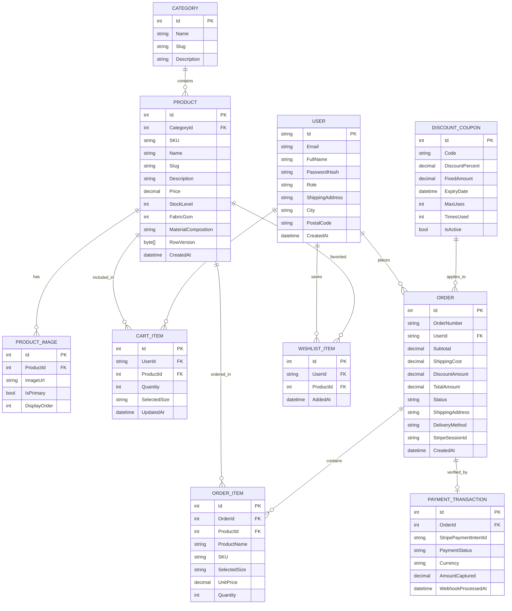

# Entity-Relationship Diagram (ERD) — VELARIS

The following diagram defines the complete relational data model powering the VELARIS online store, implemented using SQLite and Entity Framework Core.

